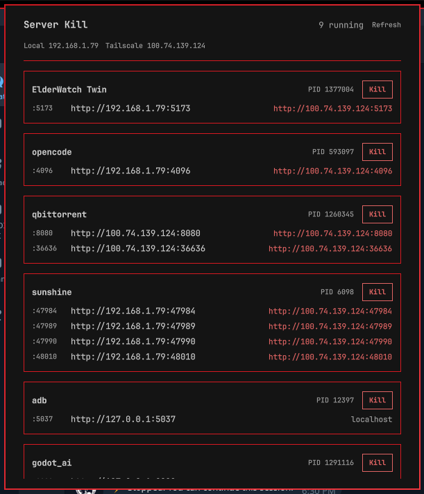

# Server Kill

Kill dev servers from the Omarchy bar — and keep them dead.

A bar widget for the [Omarchy](https://omarchy.org) Quattro shell that lists every listening server on your machine with its ports, PID, local + Tailscale URLs, and a **Kill** button. Kills are **systemd-aware**: when a server runs under a systemd user service, the widget stops the whole service (all of its child processes) and it *stays* stopped — no more services that resurrect themselves three seconds later.

Plugin id: `shaun.server-kill`



## What it does

- Lists listening servers (via `ss`), grouped by process, named sensibly (project folder, binary, or unit)
- Shows for each server: PID, ports, local URL, and a Tailscale URL for servers bound to all interfaces
- **Kill** button per server:
  - systemd-backed servers → `systemctl --user stop <unit>` — the whole process family goes down and **stays down** until you start it again or reboot
  - everything else → kills the process family cleanly (SIGTERM, then SIGKILL if needed)
  - raw-process kills are **PID-reuse safe**: the process start time recorded at scan is re-checked immediately before every signal, so a recycled or changed PID is refused, never killed
- **Stacks**: register related services as one stack (several units, containers, helpers). The panel then shows a single card with one Kill — and when the stack is stopped, a **Start** button that brings everything back
- Session-critical services (your compositor's session, etc.) are never stopped through systemd
- Auto-refreshes every 30 seconds (configurable per widget), right-click the bar icon to refresh, `R` refreshes in the panel

## Requirements

- Omarchy with the Quattro shell
- Python 3 (the bundled helpers use the standard library only)
- Optional: `systemctl` (for stopping user services), Docker (only if your stacks use containers), Tailscale (only for showing Tailscale URLs)

## Install

```bash
omarchy plugin add https://github.com/a77lic7ion/omarchy-server-kill.git --enable
```

## Usage

| Action | How |
| --- | --- |
| Open the panel | Click the bar icon |
| Close the panel | `Escape`, or click the icon again |
| Kill / stop a server | **Kill** on its card |
| Start a stopped stack | **Start** on its card |
| Refresh | **Refresh**, the `R` key, or right-click the bar icon |

## Stacks

A stack groups related services under one card (for example: a web app plus its
worker services plus a local database). Copy `stacks.json.example` to `stacks.json`
in the plugin folder and edit it:

```json
{
  "version": 1,
  "stacks": [
    {
      "id": "my-dev-stack",
      "name": "My Dev Stack",
      "description": "Web app · local database · workers",
      "cwd": "/path/to/your/project",
      "units": ["myapp-dev.service", "myapp-workers.service"],
      "ports": [5173, 54321],
      "stop": [
        "systemctl --user stop myapp-workers.service myapp-dev.service",
        "docker compose stop"
      ],
      "start": ["systemctl --user start myapp-dev.service myapp-workers.service"]
    }
  ]
}
```

- `units` / `ports` — how the scan recognises the stack in the running system
- `stop` / `start` — the commands run (through a login shell) when you press the buttons
- `cwd` — working directory for those commands

Only register services you own and understand: a Stop will take the whole stack down
on purpose. Stops are sticky — a stack stays stopped until you Start it again or reboot.

## Notes on what it touches

- **Reads**: `ss` output, `/proc` (process names, start times, systemd units), `systemctl --user is-active`, Tailscale status, and `stacks.json`
- **Commands run**: bundled `python3` helpers; `systemctl --user stop/start` for service-backed servers; the commands you write in `stacks.json`
- **Writes**: nothing outside your own services and processes — the widget never edits your config. No network access, no telemetry, everything runs as your user (no root)

## Remove

```bash
omarchy plugin remove shaun.server-kill
```

Removal leaves no cache or config files behind. If you created a `stacks.json`, delete
it with the plugin folder.

## License

MIT — see [LICENSE](LICENSE).
